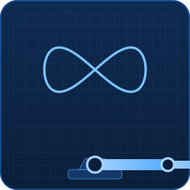
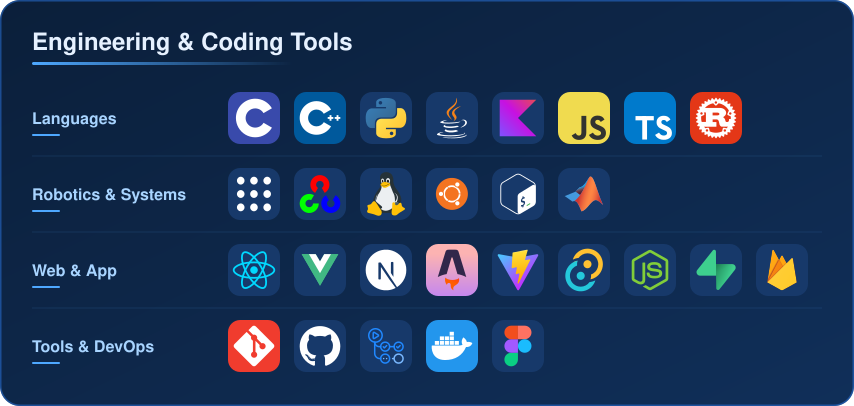
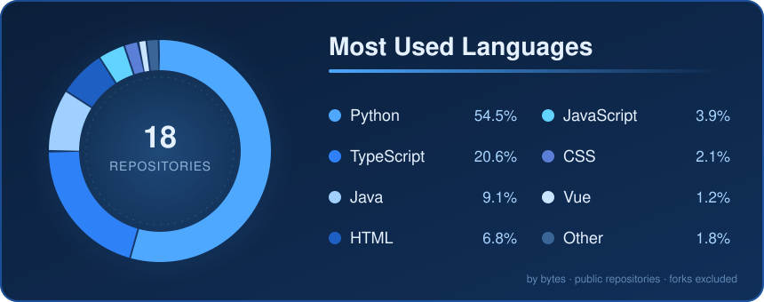
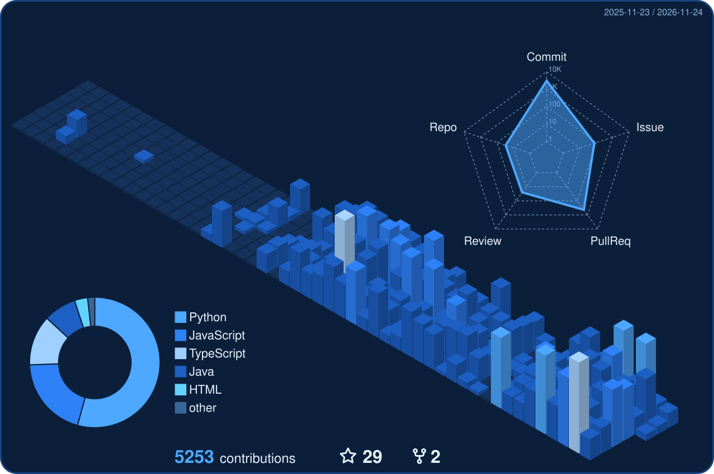

  

  안녕하세요, <b>어제의 코드에 머물지 않고 매일 진화하는 개발자 김유빈</b>입니다. 
  단순히 문제를 푸는 것에 그치지 않고, CS 지식을 근거로 지속적인 리팩토링을 거치며 
  치열했던 문제 해결 과정을 기록으로 남기는 것을 즐깁니다.

  
  
  
  

## Interests

- Physical AI & Robotics (`ROS 2`, robot-arm control, `RViz`, `Isaac Sim & Lab` simulation)
- Embedded Software & Hardware Control (`OpenRGB` device support)
- Computer Vision (`OpenCV`)
- LLM Agents & Developer Tooling (`MCP` servers, coding-agent harnesses)
- Linux & Self-hosting (`GTK4` desktop tools, self-hosted services)
- Algorithms & Problem Solving (`C++`, Baekjoon)

 

 

## Open Source Contributions

GitLab · GitHub 에서 ★100 이상 프로젝트에 병합된 기여가 **자동으로** 이 목록에 반영됩니다.

<!-- CONTRIBUTIONS:START -->

  
  
  

####  [CalcProgrammer1/OpenRGB](https://gitlab.com/CalcProgrammer1/OpenRGB) &nbsp;

- 🔵 **Merged** · [Add Colorful iGame RTX 5080 Ultra W OC support](https://gitlab.com/CalcProgrammer1/OpenRGB/-/merge_requests/3705) &nbsp;`!3705` · 2026-10-05

🤖 2026-11-25 자동 갱신 · GitLab + GitHub

<!-- CONTRIBUTIONS:END -->

## The Proof of Growth

&emsp;

  

